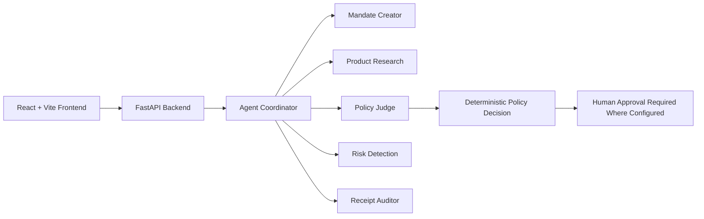

# ZENTRO – AI-Powered Intelligent Payment Authorization Platform

ZENTRO is a premium AI-assisted platform for monitoring, evaluating, and governing payment authorization decisions through a set of specialized AI agents. The project combines a React dashboard with a FastAPI backend to help review transactions, assess spending mandates, detect risk, and surface audit evidence while keeping the final authorization decision governed by deterministic policy logic.

## Project Overview

ZENTRO is designed as an intelligent payment oversight and authorization assistant for teams that need a structured, auditable approach to spending controls. The application provides:

- A real-time dashboard for spending and policy overview
- Mandate-driven transaction review
- AI-assisted merchant and receipt analysis
- Risk scoring for suspicious or high-value activity
- Human approval gates for elevated-risk flows

The AI agents are advisory components. The backend policy engine remains the authority for the final decision path, with human approval required where the configured logic requires escalation.

## Core Features

- Intelligent spending mandate parsing and evaluation
- Transaction analysis across category, amount, and policy limits
- Merchant and product research support for review context
- Risk and fraud pattern detection
- Receipt auditing and evidence validation
- Dashboard and analytics interface for monitoring activity
- JSON API layer for agent evaluation and policy operations
- Optional Gemini-based chat support when a valid API key is configured

## Five AI Agents and Responsibilities

1. Mandate Creator
   - Parses natural-language spending mandates into structured policy fields.
   - Identifies categories, spending limits, thresholds, and seller rules.

2. Product Research
   - Evaluates merchant and product context using available evidence.
   - Flags weak or missing validation signals without inventing unsupported facts.

3. Policy Judge
   - Compares transactions against active mandate conditions.
   - Determines APPROVE, REVIEW, ESCALATE, or BLOCK outcomes based on policy fit.

4. Risk Detection
   - Detects suspicious patterns, high-risk behavior, and risk scoring triggers.
   - Identifies risky merchants, duplicate signals, or weak evidence.

5. Receipt Auditor
   - Verifies whether transaction evidence and receipt metadata align with the payment record.
   - Highlights gaps, mismatches, or missing proof.

## Technology Stack

### Frontend
- React 18
- Vite
- React Router
- Recharts
- Framer Motion

### Backend
- Python 3.9+
- FastAPI
- Uvicorn
- Pydantic
- Python-dotenv

### AI / Integration
- Gemini via `google-generativeai`
- Gemini model default: `gemini-3.5-flash`

## System Architecture



## Project Structure

```text
ZENTRO/
├── ai-agents/
│   ├── agent_coordinator.py
│   ├── config.py
│   ├── mandate_creator.py
│   ├── policy_judge.py
│   ├── receipt_auditor.py
│   ├── research_agent.py
│   ├── risk_agent.py
│   ├── prompts/
│   ├── schemas/
│   └── requirements.txt
├── backend/
│   ├── server.py
│   ├── requirements.txt
│   └── server.py.backup
├── src/
│   ├── App.jsx
│   ├── main.jsx
│   ├── styles.css
│   └── services/
│       └── api.js
├── tests/
│   └── test_zentro.py
├── .env.example
├── app.js
├── index.html
├── package.json
├── package-lock.json
├── README.md
├── styles.css
├── vite.config.js
└── dist/
```

## Installation and Setup

### 1) Clone the repository

```bash
git clone <repository-url>
cd Zentro-1
```

### 2) Backend environment

```bash
python3 -m venv .venv
source .venv/bin/activate
python -m pip install --upgrade pip
pip install -r backend/requirements.txt
pip install -r ai-agents/requirements.txt
```

### 3) Frontend environment

```bash
npm install
```

### 4) Configure environment variables

Create a root `.env` file based on `.env.example`. Keep the file local-only and do not commit secrets.

```bash
cp .env.example .env
```

Minimum values:

```env
GEMINI_API_KEY=your_gemini_api_key_here
ZENTRO_GEMINI_API_KEY=your_gemini_api_key_here
AI_PROVIDER=gemini
GEMINI_MODEL=gemini-2.0-flash
```

If no valid API key is present, the app falls back to the cache/demo mode and remains safe, but it will not call Gemini.

## Running the Project

### Start the backend

```bash
cd /Users/hemas/Zentro-1
source .venv/bin/activate
uvicorn backend.server:app --host 0.0.0.0 --port 8000 --reload
```

### Start the frontend

```bash
cd /Users/hemas/Zentro-1
npm run dev -- --host 0.0.0.0 --port 5173
```

The frontend is configured to proxy `/api` and `/chat` requests to `http://127.0.0.1:8000`.

## API Documentation

FastAPI exposes interactive docs at:

- `http://127.0.0.1:8000/docs`
- `http://127.0.0.1:8000/redoc`

### Core endpoints

- `GET /api/health` — health check
- `GET /api/dashboard` — dashboard summary data
- `GET /api/agents` — agent activity metadata
- `GET /api/transactions` — transaction history
- `GET /api/mandates` — mandate definitions
- `GET /api/analytics` — analytics summary and trends
- `GET /api/settings` — settings payload
- `POST /api/settings` — save settings
- `POST /api/mandates` — create a mandate
- `PATCH /api/mandates/{mandate_id}` — toggle mandate activity
- `POST /api/policy/parse-mandate` — parse a natural-language mandate into structured rules
- `POST /api/policy/evaluate` — evaluate a purchase against a mandate
- `POST /api/agents/evaluate` — run the multi-agent review pipeline
- `POST /chat/message` — AI support chat with a Gemini fallback

## Troubleshooting

### Backend connection refused from the frontend

Check that the backend is running on port 8000 and that Vite is proxying `/api` and `/chat` to `http://127.0.0.1:8000`.

```bash
curl http://127.0.0.1:8000/api/health
```

If this fails, start the backend first.

### Missing dependency errors

```bash
source .venv/bin/activate
python -m pip install -r backend/requirements.txt
python -m pip install -r ai-agents/requirements.txt
```

### Gemini unavailable

The app remains operational without a key, but the AI chatbot and Gemini-backed agents will fall back to cached/demo responses. Do not hard-code keys in frontend code or commit them to the repo.

## How It Works

1. The React frontend requests data from the FastAPI backend.
2. The backend loads policy state from SQLite and serves dashboard, transaction, and mandate data.
3. The agent coordinator evaluates the transaction using the configured agents.
4. The backend policy engine makes the final deterministic decision and stores the result.
5. If the rules require escalation, the system requests human approval rather than auto-authorizing the payment.

## Notes

- Python 3.11+ is strongly recommended for the latest Google client compatibility.
- This project keeps the deterministic policy engine as the final authority.
- AI outputs are advisory and never automatically authorize a payment.

## Team Contributors

- Hema
- Shivani
- Ponnanna
- Niranjan

## Notes

This project is implemented as a working AI policy review and dashboard prototype with a deterministic safety boundary. The AI agents provide analysis and recommendations, but the backend policy logic remains the decision authority and human approval is required where escalation is configured.
