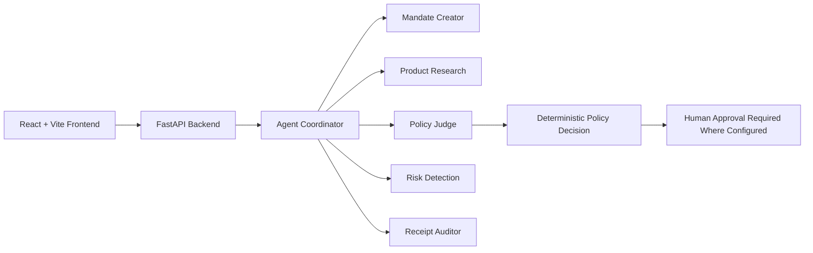

# ZENTRO – AI-Powered Intelligent Payment Authorization Platform

ZENTRO is a premium AI-assisted platform for monitoring, evaluating, and governing payment authorization decisions through a set of specialized AI agents. The project combines a React dashboard with a FastAPI backend to help review transactions, assess spending mandates, detect risk, and surface audit evidence while keeping the final authorization decision governed by deterministic policy logic.

## Project Overview

ZENTRO is designed as an intelligent payment oversight and authorization assistant for teams that need a structured, auditable approach to spending controls. The application provides:

- A real-time dashboard for spending and policy overview
- Mandate-driven transaction review
- AI-assisted merchant and receipt analysis
- Risk scoring for suspicious or high-value activity
- Human approval gates for elevated-risk flows

The AI agents are advisory components. The backend policy engine remains the authority for the final decision path, with human approval required where the configured logic requires escalation.

## Core Features

- Intelligent spending mandate parsing and evaluation
- Transaction analysis across category, amount, and policy limits
- Merchant and product research support for review context
- Risk and fraud pattern detection
- Receipt auditing and evidence validation
- Dashboard and analytics interface for monitoring activity
- JSON API layer for agent evaluation and policy operations
- Optional Gemini-based chat support when a valid API key is configured

## Five AI Agents and Responsibilities

1. Mandate Creator
   - Parses natural-language spending mandates into structured policy fields.
   - Identifies categories, spending limits, thresholds, and seller rules.

2. Product Research
   - Evaluates merchant and product context using available evidence.
   - Flags weak or missing validation signals without inventing unsupported facts.

3. Policy Judge
   - Compares transactions against active mandate conditions.
   - Determines APPROVE, REVIEW, ESCALATE, or BLOCK outcomes based on policy fit.

4. Risk Detection
   - Detects suspicious patterns, high-risk behavior, and risk scoring triggers.
   - Identifies risky merchants, duplicate signals, or weak evidence.

5. Receipt Auditor
   - Verifies whether transaction evidence and receipt metadata align with the payment record.
   - Highlights gaps, mismatches, or missing proof.

## Technology Stack

### Frontend
- React 18
- Vite
- React Router
- Recharts
- Framer Motion

### Backend
- Python 3.9+
- FastAPI
- Uvicorn
- Pydantic
- Python-dotenv

### AI / Integration
- Gemini via `google-generativeai`
- Gemini model default: `gemini-3.5-flash`

## System Architecture



## Project Structure

```text
ZENTRO/
├── ai-agents/
│   ├── agent_coordinator.py
│   ├── config.py
│   ├── mandate_creator.py
│   ├── policy_judge.py
│   ├── receipt_auditor.py
│   ├── research_agent.py
│   ├── risk_agent.py
│   ├── prompts/
│   ├── schemas/
│   └── requirements.txt
├── backend/
│   ├── server.py
│   ├── requirements.txt
│   └── server.py.backup
├── src/
│   ├── App.jsx
│   ├── main.jsx
│   ├── styles.css
│   └── services/
│       └── api.js
├── tests/
│   └── test_zentro.py
├── .env.example
├── app.js
├── index.html
├── package.json
├── package-lock.json
├── README.md
├── styles.css
├── vite.config.js
└── dist/
```

## Installation and Setup

### 1) Clone the repository

```bash
git clone <repository-url>
cd Zentro-1
```

### 2) Backend environment

```bash
python3 -m venv .venv
source .venv/bin/activate
pip install -r backend/requirements.txt
pip install -r ai-agents/requirements.txt
```

### 3) Frontend environment

```bash
npm install
```

## Gemini API Configuration

Create a root `.env` file based on the provided `.env.example`:

```env
GEMINI_API_KEY=your_gemini_api_key_here
```

The application also supports alternate environment names:

```env
ZENTRO_GEMINI_API_KEY=your_gemini_api_key_here
```

If no valid API key is present, the app still runs in cache/demo mode and uses backend fallback responses.

## Running the Project

### Start the backend

From the project root:

```bash
python3 -m uvicorn backend.server:app --host 0.0.0.0 --port 8000
```

### Start the frontend

```bash
npm run dev -- --host 0.0.0.0
```

Then open the app in the browser using the local Vite address shown in the terminal output.

## API Documentation

The backend exposes JSON endpoints through FastAPI.

### Core endpoints

- `GET /api/health` — health check
- `GET /api/dashboard` — dashboard summary data
- `GET /api/agents` — agent activity metadata
- `GET /api/transactions` — transaction list
- `GET /api/mandates` — mandate definitions
- `GET /api/analytics` — analytics summary and trends
- `GET /api/settings` — settings payload

### Write/update endpoints

- `POST /api/settings` — updates application settings
- `POST /api/mandates` — creates a mandate
- `PATCH /api/mandates/{mandate_id}` — toggles mandate activity
- `POST /api/agents/evaluate` — evaluates a transaction through the coordinator and all agents
- `POST /api/agents/parse-mandate` — parses a mandate text input into structured policy data
- `POST /chat/message` — chat endpoint with Gemini fallback

## How It Works

1. The user interacts with the dashboard or transaction flows in the React frontend.
2. The frontend calls the FastAPI service for dashboard, analytics, mandate, and transaction data.
3. The backend runs the multi-agent evaluation pipeline through the coordinator.
4. Each agent contributes a decision, risk signal, and policy context.
5. The deterministic backend policy engine synthesizes the final authorization decision.
6. If the workflow requires escalation, the system marks the requirement for human approval before proceeding.

## Team Contributors

- Hema
- Shivani
- Ponnanna
- Niranjan

## Notes

This project is implemented as a working AI policy review and dashboard prototype with a deterministic safety boundary. The AI agents provide analysis and recommendations, but the backend policy logic remains the decision authority and human approval is required where escalation is configured.
